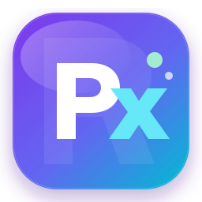

# PX STUDIO CREATOR

<p align="center">
  
</p>

<p align="center">
  <b>AI Video Editing &amp; Creative Studio</b><br/>
  Gabungkan clip, susun montage, olah audio, dan render video MP4 secara nyata dengan Next.js + FFmpeg.
</p>

<p align="center">
  
  
  
  
  
  
</p>

<p align="center">
  <a href="https://www.buymeacoffee.com/" target="_blank">
    
  </a>
</p>

---

**PX STUDIO CREATOR** adalah platform AI video editing & creative studio berbasis **Next.js (App Router)** untuk menggabungkan clip, menyusun montage, mengekstrak/mengelola audio, menganalisis beat musik, membuat caption/TTS, dan merender video secara nyata menggunakan **FFmpeg** + background worker.

> Dikembangkan dari sistem sebelumnya (rebrand & upgrade) dengan tetap mempertahankan alur inti yang sudah berjalan.

## Fitur Utama

- **AI Clip Studio** — upload video, analisis highlight (AI/heuristik), render clip MP4.
- **AI Montage Maker** — pilih/upload beberapa clip + musik, atur urutan/trim, preset (cinematic/AMV/hype/emotional/clean/story), aspect/FPS/audio mode, generate plan (auto/custom), render montage via worker (FFmpeg xfade/concat/audio mix).
- **AI Prompt Editor** — tulis instruksi editing & template, terjemahkan ke konfigurasi/preset montage.
- **Tambah Suara ke Video** — mix/replace audio, Audio Library, Extract Audio, dan **Auto Beat** (analisis beat/BPM/marker, sync plan, render sinkron musik via FFmpeg).
- **Auto Caption** — transkripsi (STT/fallback), generate SRT, burn-in subtitle ke video bila memungkinkan.
- **Audio Extractor & Audio Library** — ekstrak audio (MP3/WAV/AAC/M4A, trim start/end), simpan/preview/rename/download/hapus.
- **Text to Speech (TTS)** — generate suara dengan fallback yang tersedia.
- **YouTube AutoClip** — buat project dari link YouTube (unduh via `yt-dlp`, proses clip).
- **Project/Job Management** — tracking status, preview & download hasil render.
- **Background Worker** — job queue di database; worker otomatis berjalan di server Node (`instrumentation`).
- **AI Gateway (9Router-only)** — konfigurasi via `.env` server-side, model aktif global di Settings (tanpa provider manager/routing di dashboard).

## Tech Stack

- **Frontend/Backend:** Next.js 16 (App Router) + React 19 + TypeScript
- **UI:** Tailwind CSS 4, komponen kustom, ikon Lucide
- **Database/ORM:** Prisma + SQLite
- **Media/Render:** FFmpeg / FFprobe
- **AI:** endpoint OpenAI-compatible (gateway 9Router)

## Prasyarat

- **Node.js 20+** dan **npm**
- **FFmpeg** dan **FFprobe** tersedia di PATH (atau set di `.env`)
- **Python 3** (untuk analisis beat/audio tertentu; `numpy`/`scipy` direkomendasikan)
- (Opsional) **yt-dlp** untuk fitur YouTube AutoClip
- (Opsional) endpoint AI OpenAI-compatible (9Router) untuk analisis/penalaran AI

## Instalasi & Menjalankan

1. **Clone & install dependencies**
   ```bash
   git clone https://github.com/p3yx/px-studio-creator.git
   cd px-studio-creator
   npm install
   ```
2. **Siapkan environment**
   ```bash
   copy .env.example .env
   ```
   Atur minimal `AUTH_SECRET`. Konfigurasi gateway AI (9Router) dan path tool (FFmpeg/yt-dlp) melalui `.env` sesuai kebutuhan.
3. **Inisialisasi database & Prisma client**
   ```bash
   npm run db:generate
   npm run db:push
   ```
4. **Jalankan aplikasi**
   ```bash
   npm run dev
   # atau production
   npm run build
   npm run start
   ```
   Buka: `http://localhost:3000`

> **Catatan:** background worker otomatis aktif saat server berjalan (Node runtime). Opsi manual: `npm run worker`.

## Konfigurasi Penting (`.env`)

- `AUTH_SECRET` — secret autentikasi (wajib di production)
- `FFMPEG_PATH` / `FFPROBE_PATH` — path FFmpeg/FFprobe (opsional jika sudah di PATH)
- `AI_API_BASE_URL` / `AI_API_KEY` / `AI_DEFAULT_MODEL` — gateway AI (9Router, server-side)
- `YTDLP_PATH` — path `yt-dlp` untuk YouTube AutoClip

Lihat `.env.example` untuk daftar lengkap.

## Struktur Proyek

```text
src/
  app/            # Halaman & API routes (dashboard, projects, ai-studio, auth, dll.)
  components/     # UI shell, brand, komponen
  lib/            # db, auth, storage, ffmpeg, ai, analysis, montage, beat, worker
prisma/
  schema.prisma   # Model data (user, project, clip, job, montage/audio assets, settings)
public/           # Aset statis & ikon
storage/          # File sumber/hasil render (gitignored)
```

## Ikon & Branding

Aset ikon modern tersedia di:
- `public/logo.svg`, `public/logo-mark.svg` — logo/mark PX STUDIO CREATOR
- `src/app/icon.svg` & `src/app/favicon.ico` — ikon aplikasi (Next.js App Router)

## Catatan

- Proses video/audio sangat bergantung resource host (CPU/RAM/disk). Render berat disarankan pada durasi/segmen yang wajar.
- Gunakan hanya media yang Anda miliki atau memiliki izin penggunaan/distribusinya.
- Kemampuan AI (STT/caption/prompt) bergantung pada ketersediaan & kompatibilitas model di gateway yang dikonfigurasi.

## Dukungan

Jika project ini bermanfaat, Anda bisa mendukung pengembang:

<a href="https://www.buymeacoffee.com/" target="_blank">
  
</a>

## Lisensi

Belum ditentukan. Tambahkan file `LICENSE` sesuai kebutuhan distribusi Anda.
